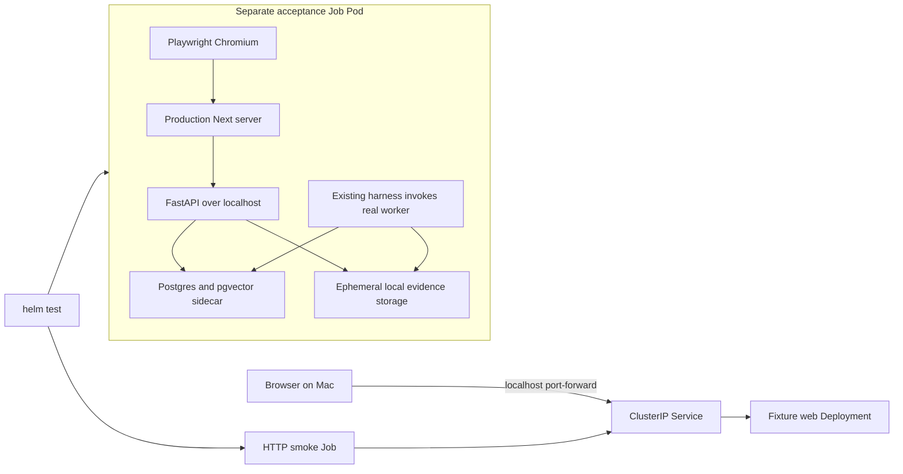

# Reproduce the FEL Kubernetes and Helm lab

Research date: 2026-11-15. Application baseline:
`5a7b833c385131fa83388a93d6c3363211209832`. Implementation is reviewed in
[#436](https://github.com/wilsonhj/Agentic-Financial-Evidence-Lab/pull/436),
tracked by [#435](https://github.com/wilsonhj/Agentic-Financial-Evidence-Lab/issues/435).
Read the [external agent handoff](../../infra/kubernetes/CLAUDE-HANDOFF.md)
before continuing this work.

This optional lab packages the existing application for local testing without
changing its authentication, evidence or provider contracts. It deploys an
interactive fixture UI and runs a separate, real browser/API/Postgres/worker
acceptance stack using synthetic evidence and deterministic model output.
It does not deliver a public, live-data FEL service. The accepted production
stack and release gates still govern; draft hosting changes in
[#431](https://github.com/wilsonhj/Agentic-Financial-Evidence-Lab/pull/431)
are a separate proposal.

## 1. Understand what the chart runs



The fixture Deployment is useful for browsing screens. Its HTTP smoke checks
the deployed Service. The cross-stack Job independently verifies migrations,
seeded evidence, HTTP requests, durable queue work, proposals, approval,
correction and historical immutability through the existing
[acceptance test](../../apps/web/e2e/extraction-cross-stack.acceptance.ts).
It does **not** claim that the fixture Deployment talks to a database.

This layout follows the code. The
[deployment guard](deployment-guard-contract.md) requires loopback API/DB
addresses for synthetic mode. Separate Kubernetes Pods do not share loopback,
even on the same node. Containers in one Pod do. The database is a native
sidecar so its continued operation does not prevent the test Job completing.
The chart requires Kubernetes 1.33 or later, where that feature is stable.
See [Pod networking](https://kubernetes.io/docs/concepts/workloads/pods/#pod-networking)
and [sidecar Jobs](https://kubernetes.io/docs/concepts/workloads/pods/sidecar-containers/).

## 2. Choose a machine and reserve resources

Start with one cluster on one Mac. All three machines use native ARM64 images.
Do not emulate AMD64 for this lab. The following allocations are starting
budgets, not measured capacity guarantees. Allocate them to Docker Desktop's
Linux VM for kind, or to the Ubuntu VM for Vagrant, not to both simultaneously.

| Mac | Initial Linux allocation | Suggested use |
| --- | --- | --- |
| MacBook Pro, 16 GB | 8 GiB RAM, 4 CPUs | One node, one acceptance run at a time; leave Argo CD/Kargo off initially |
| M4 Pro Mac mini, 24 GB | 12 GiB RAM, 6 CPUs | Preferred everyday lab; optional Argo CD/Kargo after baseline passes |
| M1 Max Mac Studio, 32 GB | 16 GiB RAM, 8 CPUs | More room for controllers and two sequential environment promotions |

Reserve roughly 30 GB free disk for images, build cache and cluster state.
The acceptance runner has a 4 GiB limit and performs a Next production build.
Build images sequentially, close memory-heavy applications on the 16 GB Mac,
and inspect host memory pressure before increasing replicas. Do not infer
production throughput from these synthetic runs. The specification's release
performance reference includes separate 32 GB application and database hosts.

## 3. Obtain a clean checkout and pinned tools

Install and start Docker Desktop for Apple Silicon. The lab script uses its
Docker engine but does not enable Docker Desktop's built-in Kubernetes.
Use a fresh directory so your application worktree remains untouched.

```bash
git clone --branch agent/435-helm-lab \
  https://github.com/wilsonhj/Agentic-Financial-Evidence-Lab.git fel-helm-lab
cd fel-helm-lab
git rev-parse HEAD

export FEL_LAB_TOOLS="$HOME/.local/share/fel-lab/bin"
bash infra/kubernetes/bootstrap-tools.sh "$FEL_LAB_TOOLS"
export PATH="$FEL_LAB_TOOLS:$PATH"
export FEL_LAB_STATE="$HOME/.local/share/fel-lab/state"
export FEL_LAB_CLUSTER=fel-helm-lab
bash infra/kubernetes/lab.sh doctor
```

After merge, use the reviewed merge SHA instead of the implementation branch.
Record the exact SHA in your test report. The bootstrap script downloads and
checks release SHA256 files for Helm 3.22.1, kind 0.33.0 and kubectl 1.37.0.
It does not use sudo or change shell startup files. The kind node image is
Kubernetes 1.37.0 pinned to its multi-platform manifest digest. These versions
were selected together from the
[kind release](https://github.com/kubernetes-sigs/kind/releases/tag/v0.33.0),
[Helm 3 installation documentation](https://helm.sh/docs/v3/intro/install/)
and [kubectl version-skew policy](https://kubernetes.io/releases/version-skew-policy/).

## 4. Build, deploy and browse

```bash
bash infra/kubernetes/lab.sh build
bash infra/kubernetes/lab.sh create
bash infra/kubernetes/lab.sh deploy
bash infra/kubernetes/lab.sh status
bash infra/kubernetes/lab.sh open
```

Open `http://127.0.0.1:3000`, then stop the port forward with Ctrl-C when done.
If another application uses port 3000, run
`FEL_LAB_PORT=13000 bash infra/kubernetes/lab.sh open` and browse port 13000.
`build` requires a clean checkout and tags both images with its commit SHA.
`create` writes only the lab's separate kubeconfig. `deploy` loads images
directly into the named kind cluster and installs the chart. No registry
account, Supabase project, SEC request or model-provider credential is needed.
kind's explicit image loading and kubeconfig behavior are documented in its
[quick start](https://kind.sigs.k8s.io/docs/user/quick-start/).

The files to adapt are:

| File | Purpose |
| --- | --- |
| [Chart.yaml](../../infra/helm/fel/Chart.yaml) | Chart identity, version and minimum Kubernetes version |
| [values.yaml](../../infra/helm/fel/values.yaml) | Image references and local resource limits |
| [values.schema.json](../../infra/helm/fel/values.schema.json) | Reject unsupported settings before rendering |
| [templates](../../infra/helm/fel/templates/) | Fixture Deployment/Service and test Jobs |
| [image recipes](../../infra/kubernetes/images/) | Separate fixture and test images with explicit build-context exclusions |
| [run-acceptance.sh](../../infra/kubernetes/run-acceptance.sh) | Guarded migration/seed/browser-test entrypoint |
| [lab.sh](../../infra/kubernetes/lab.sh) | Repeatable cluster lifecycle with explicit context selection |

The image recipes deliberately live outside `infra/docker/`, which draft
#431 owns. The acceptance image contains development dependencies because it
runs tests; do not reuse it as a production application image. The Helm chart
does not introduce Redis, an LLM server or a full Supabase installation.
The Node and pgvector base images are pinned by multi-platform digest, and
application dependencies use the repository locks. Debian OS packages are
resolved at build time, so retain the built image digest for exact artifact
reproduction rather than assuming every future rebuild is byte-identical.

## 5. Run the tests and preserve the evidence

```bash
bash infra/kubernetes/lab.sh test
```

Success means both Helm test Jobs exit zero. The first probes the deployed
fixture Service. The second starts a fresh pgvector database, applies and checks
the migration ledger, seeds the canonical manifest, then runs the unchanged
production-build cross-stack browser test. It uses one Playwright worker.
The script propagates Helm's exit code and archives timestamped logs, events
and workload status under `$FEL_LAB_STATE/evidence`.

The database login in the chart is an intentionally public, disposable test
identity. PostgreSQL listens only on Pod loopback and has no Service. Test
data and evidence storage use `emptyDir`; no existing database can be supplied
through chart values. The runner validates its exact local target before
migrations. Do not inject real credentials into either lab image or Pod.

Logs are available after a Job completes. Browser traces and files inside a
terminated container are not exported by this first version; `kubectl cp`
requires a running container. For durable trace bundles, add an explicitly
owned artifact volume/export step before container exit. Capture logs before
rerunning a test because hook recreation removes the prior Job. A rendered
NetworkPolicy alone does not establish isolation: enforcement depends on the
cluster CNI. kind's default kindnet does not enforce NetworkPolicy. The
loopback bind and absent database Service remain intentional.

Useful diagnostics, always with the lab kubeconfig:

```bash
kubectl --kubeconfig "$FEL_LAB_STATE/kubeconfig" -n fel-lab get pods,jobs
kubectl --kubeconfig "$FEL_LAB_STATE/kubeconfig" -n fel-lab \
  describe job fel-lab-acceptance
kubectl --kubeconfig "$FEL_LAB_STATE/kubeconfig" -n fel-lab \
  logs job/fel-lab-acceptance -c acceptance
```

For `Pending`, inspect scheduling events and available memory. For
`ErrImageNeverPull`, rebuild/load the exact tagged image into the named cluster.
For `OOMKilled`, inspect Docker allocation and other workloads before changing
limits. A startup probe failure is a database initialization failure, not an
application test failure. A test assertion failure is evidence to investigate;
do not weaken the deployment guard or silently accept a skipped database test.

## 6. Use the original Ubuntu/Vagrant configuration instead

The original
[Ubuntu2404-multiplatform source](https://github.com/wdlostone/vagrant_examples/tree/2dc9525a9448591a4a859d6fac66f38017a3d88c/Ubuntu2404-multiplatform)
can supply the cluster. Its defaults create three VMs at 4 GiB each, consuming
12 GiB before macOS and builds. Use the pinned source in a separate clone and
an ARM64 Ubuntu box with a compatible provider, such as VMware Fusion plus
the Vagrant VMware utility/plugin. Do not assume an x86 VirtualBox box runs
on Apple Silicon. Review the provider and box metadata before provisioning.

For a single-node 16 GB machine, set `WORKER_COUNT=0`, `NODE_MEMORY=8192`,
`NODE_CPUS=4`, `INSTALL_ARGOCD=false`, and `INSTALL_KARGO=false` when running
Vagrant. Use 12288/6 or 16384/8 for the larger Macs. Make the control-plane
node schedulable in that disposable cluster:

```bash
export FEL_VAGRANT_KUBECONFIG=/absolute/path/to/this-lab-kubeconfig
kubectl --kubeconfig "$FEL_VAGRANT_KUBECONFIG" config current-context
kubectl --kubeconfig "$FEL_VAGRANT_KUBECONFIG" get nodes -o wide
# Confirm these are the dedicated Vagrant lab nodes before changing scheduling.
kubectl --kubeconfig "$FEL_VAGRANT_KUBECONFIG" \
  taint nodes --all node-role.kubernetes.io/control-plane-
```

The pinned Vagrantfile rejects the built-in Argo/Kargo add-on flags with zero
workers. Its Argo installer also waits specifically for a worker-labelled
node. Untainting the control plane does not fix those checks. Keep the flags
off and install controllers manually, or adapt both checks to require a
Ready, schedulable node. For two VMs the upstream memory setting applies to
each VM, so 8192 means 16 GiB total. Per-node memory needs a Vagrantfile change.
See [kubeadm control-plane isolation](https://kubernetes.io/docs/setup/production-environment/tools/kubeadm/create-cluster-kubeadm/#control-plane-node-isolation).

Build images on the Mac and publish to an accessible registry, or import image
archives into **every schedulable node's** containerd `k8s.io` namespace.
`kind load` applies only to kind. For Vagrant, use `helm upgrade --install`
directly with the guest cluster kubeconfig, appropriate image repositories and
`IfNotPresent` pull policies. This chart uses ephemeral storage; a future
persistent application chart needs an explicitly installed storage provisioner.

## 7. Connect Argo CD and Kargo

Follow the [GitOps guide](../../infra/kubernetes/GITOPS.md) after the local
tests pass. The chain is source commit → immutable images → versioned OCI
chart → Kargo promotion commit → Argo CD sync → acceptance Jobs.
Argo CD renders the chart. Kargo advances the chart version recorded in an
environment wrapper. They serve different roles and need separate credentials.

## 8. What remains for a persistent full FEL deployment

These are substantive application/operations changes, outside this small lab
PR. Keep their existing owners and contracts rather than treating YAML as
implementation evidence:

1. Implement the public request-scoped session/BYOK contract and runtime
   provider binding. Public routes currently fail closed; setting a mock flag
   does not establish public authentication or live inference readiness.
2. Give API and worker services production-suitable shared object storage,
   explicit database roles and secret references. Current local directory
   storage cannot become multi-node shared storage by adding two PVCs.
3. Define a cluster-appropriate integrated test contract if API and database
   must live in different Pods. The accepted synthetic loopback restriction
   must not be removed as a convenience fix.
4. Add persistent database management or a managed database, restore evidence,
   migration ordering, retry/idempotency checks, shutdown handling, ingress/TLS,
   resource measurements and production-grade readiness checks. `/health` is
   currently process liveness, not proof that migrations, storage or a queue
   are usable.
5. Use separate immutable web/API/worker images for long-running services,
   one migration Job with its own credential, and the existing financial,
   temporal, citation, tenant-isolation and release acceptance gates.

For an in-cluster database under Argo CD, ordering normally places storage and
database readiness before a migration **Sync** hook and then applications.
A PreSync migration cannot connect to a database that has not been created on
the first sync. For plain Helm, provide an equivalent explicit bootstrap
sequence. Do not assume `depends_on` from Compose exists in Kubernetes.
See [Argo sync waves](https://argo-cd.readthedocs.io/en/stable/user-guide/sync-waves/)
and [persistent-volume access modes](https://kubernetes.io/docs/concepts/storage/persistent-volumes/#access-modes).

## 9. Clean up

```bash
bash infra/kubernetes/lab.sh delete
```

This deletes only the named, recorded lab cluster. Evidence remains in the
state directory. Images/build cache remain available for the next run. Do not
use a global Docker prune command as part of this procedure.

## Verification record

On 2026-11-15, the native ARM64 validation used Docker 28.0.1 with
8,218,034,176 bytes (about 7.65 GiB) and 10 CPUs allocated to its Linux VM,
kind 0.33.0, Kubernetes 1.37.0, Helm 3.22.1 and kubectl 1.37.0.

| Check | Observed outcome |
| --- | --- |
| Pinned CLI downloads | Published SHA256 checks passed |
| Image builds | Both ARM64 images built; Python dependency check passed |
| Fixture image offline | Health and extraction page returned HTTP 200 |
| Helm lint/render | Default, Argo, fixture-only, digest and dependency-wrapper variants passed |
| Invalid configuration | Unsupported Kubernetes version/public overrides and invalid images rejected |
| Runner target checks | 12 DSN/environment cases checked; unsafe targets refused |
| Deployed Service smoke | Job succeeded, health and extraction UI HTTP 200 |
| Full synthetic acceptance | Job succeeded; 13 migrations, real API/worker/browser flow, one Playwright test passed |

The first passing full test completed at 20:00:46 UTC. Logs were saved under
`/tmp/fel-435-validation/evidence`. The validation cluster used its own
kubeconfig and did not change the default Kubernetes context. The final PR
records the reviewed source/image identities and subsequent checks.

AMD64 image builds, each named Mac's capacity, VMware/Vagrant provisioning,
OCI publication, Argo CD/Kargo installation and actual promotions were not
executed. Their instructions are source-backed reproduction steps. Running
this lab does not satisfy hosted or live-provider release gates.
