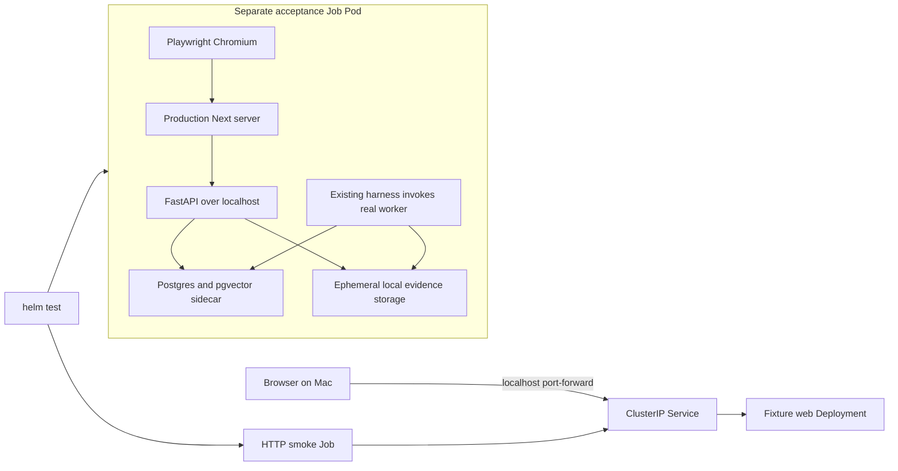

# Reproduce the FEL Kubernetes and Helm lab

Research date: 2026-11-15; validation follow-up: 2026-11-16 UTC. The original
application baseline was `5a7b833c385131fa83388a93d6c3363211209832`, delivered in
[#436](https://github.com/wilsonhj/Agentic-Financial-Evidence-Lab/pull/436)
under [#435](https://github.com/wilsonhj/Agentic-Financial-Evidence-Lab/issues/435).
The current reproduction and delivery follow-up is
[#439](https://github.com/wilsonhj/Agentic-Financial-Evidence-Lab/issues/439).
The verification record below distinguishes the tested image source from the
validator source; a later documentation commit does not change that evidence.
Read the [external agent handoff](../../infra/kubernetes/CLAUDE-HANDOFF.md)
before continuing this work; its original #435 branch instructions are
superseded by the #439 checkout and validation sequence below.

This optional lab packages the existing application for local testing without
changing its authentication, evidence or provider contracts. It deploys an
interactive fixture UI and runs a separate, real browser/API/Postgres/worker
acceptance stack using synthetic evidence and deterministic model output.
It does not deliver a public, live-data FEL service. The accepted production
stack and release gates still govern. [ADR-0035](../decisions/ADR-0035-vercel-hosting.md)
selects Vercel and Neon for hosted deployment. The separate
[persistent Kubernetes proposal](kubernetes-persistent-deployment.md) defines
the additional contracts and review needed for a persistent cluster service.

## 1. Understand what the chart runs



The fixture Deployment is useful for browsing screens. Its HTTP smoke checks
the deployed Service. The cross-stack Job independently verifies migrations,
seeded evidence, HTTP requests, durable queue work, proposals, approval,
correction and historical immutability through the existing
[acceptance test](../../apps/web/e2e/extraction-cross-stack.acceptance.ts).
It does **not** claim that the fixture Deployment talks to a database.

This layout follows the code. The
[deployment guard](deployment-guard-contract.md) requires loopback API/DB
addresses for synthetic mode. Separate Kubernetes Pods do not share loopback,
even on the same node. Containers in one Pod do. The database is a native
sidecar so its continued operation does not prevent the test Job completing.
The chart requires Kubernetes 1.33 or later, where that feature is stable.
See [Pod networking](https://kubernetes.io/docs/concepts/workloads/pods/#pod-networking)
and [sidecar Jobs](https://kubernetes.io/docs/concepts/workloads/pods/sidecar-containers/).

## 2. Choose a machine and reserve resources

Start with one cluster on one Mac. All three machines use native ARM64 images.
Do not emulate AMD64 for this lab. The following allocations are starting
budgets, not measured capacity guarantees. Allocate them to Docker Desktop's
Linux VM for kind, or to the Ubuntu VM for Vagrant, not to both simultaneously.

| Mac | Initial Linux allocation | Suggested use |
| --- | --- | --- |
| M1 Pro MacBook Pro, 16 GB | 8 GiB RAM, 4 CPUs | One node, one acceptance run at a time; leave Argo CD/Kargo off initially |
| M4 Pro Mac mini, 24 GB | 12 GiB RAM, 6 CPUs | Preferred everyday lab; optional Argo CD/Kargo after baseline passes |
| M1 Max Mac Studio, 32 GB | 16 GiB RAM, 8 CPUs | More room for controllers and two sequential environment promotions |

Reserve roughly 30 GB free disk for images, build cache and cluster state.
The acceptance runner has a 4 GiB limit and performs a Next production build.
Build images sequentially, close memory-heavy applications on the 16 GB Mac,
and inspect host memory pressure before increasing replicas. Do not infer
production throughput from these synthetic runs. The specification's release
performance reference includes separate 32 GB application and database hosts.

The measured run used the 16 GB M1 Pro: Docker reported 7.65 GiB RAM and
10 virtual CPUs, while the kind node container was capped at four CPUs.
The 24 GB and 32 GB machines have **not** been measured. Set Docker Desktop's
VM allocation manually using the table before running their profiles below;
the shell variables select an isolated state directory and node CPU cap, and
do not reconfigure Docker Desktop's VM memory.

## 3. Obtain a clean checkout and pinned tools

Install and start Docker Desktop for Apple Silicon. The lab script uses its
Docker engine but does not enable Docker Desktop's built-in Kubernetes.
Use a fresh directory so your application worktree remains untouched.

Run these examples in Bash. Install Python 3.11, matching `.python-version`,
for the local regression gate. The cluster validator itself is standard-library
Python and also parses on Python 3.9; select its interpreter explicitly.

```bash
set -euo pipefail
git clone --branch agent/439-platform-validation \
  https://github.com/wilsonhj/Agentic-Financial-Evidence-Lab.git fel-helm-lab
cd fel-helm-lab
git rev-parse HEAD

export FEL_LAB_TOOLS="$HOME/.local/share/fel-lab/bin"
bash infra/kubernetes/bootstrap-tools.sh "$FEL_LAB_TOOLS"
export PATH="$FEL_LAB_TOOLS:$PATH"

# Select exactly one: macbook16, mini24, or studio32.
export FEL_LAB_PROFILE=macbook16
case "$FEL_LAB_PROFILE" in
  macbook16) export FEL_LAB_NODE_CPUS=4 ;;
  mini24) export FEL_LAB_NODE_CPUS=6 ;;
  studio32) export FEL_LAB_NODE_CPUS=8 ;;
  *) echo 'Unknown FEL lab profile' >&2; exit 2 ;;
esac
export FEL_LAB_STATE="$HOME/.local/share/fel-lab/$FEL_LAB_PROFILE"
export FEL_LAB_CLUSTER="fel-$FEL_LAB_PROFILE"
export FEL_KUBECONFIG="$FEL_LAB_STATE/kubeconfig"
export FEL_KUBE_CONTEXT="kind-$FEL_LAB_CLUSTER"
bash infra/kubernetes/lab.sh doctor
```

After merge, use the reviewed merge SHA instead of the implementation branch.
Record the exact SHA in your test report. The bootstrap script downloads and
checks release SHA256 files for Helm 3.22.1, kind 0.33.0 and kubectl 1.37.0.
It does not use sudo or change shell startup files. The kind node image is
Kubernetes 1.37.0 pinned to its multi-platform manifest digest. These versions
were selected together from the
[kind release](https://github.com/kubernetes-sigs/kind/releases/tag/v0.33.0),
[Helm 3 installation documentation](https://helm.sh/docs/v3/intro/install/)
and [kubectl version-skew policy](https://kubernetes.io/releases/version-skew-policy/).

Create a small Python environment outside the checkout and install only the
hash-locked YAML dependency used by the lab checks:

```bash
python3.11 -m venv "$HOME/.local/share/fel-lab/python"
export FEL_LAB_PYTHON="$HOME/.local/share/fel-lab/python/bin/python"
export FEL_LAB_PYYAML_LOCK="$(mktemp)"
"$FEL_LAB_PYTHON" - <<'PY'
import os
from pathlib import Path
text = Path("requirements-dev.lock").read_text()
block = "pyyaml==" + text.split("\npyyaml==", 1)[1].split("\n    #", 1)[0] + "\n"
Path(os.environ["FEL_LAB_PYYAML_LOCK"]).write_text(block)
PY
"$FEL_LAB_PYTHON" -m pip install --require-hashes --no-deps -r "$FEL_LAB_PYYAML_LOCK"
rm -f "$FEL_LAB_PYYAML_LOCK"
bash infra/kubernetes/check-lab.sh
```

`check-lab.sh` requires Helm and PyYAML, checks shell syntax and strict Helm
lint, and fails on any failed, skipped or absent test. It covers default,
Argo, fixture-only, digest and dependency-wrapper rendering, and rejects old
Kubernetes versions, unsupported environments and invalid images. This is the
same gate used by the [Kubernetes lab workflow](../../.github/workflows/kubernetes-lab.yml).
Its optional manual ARM64 cluster job runs deployment and acceptance separately.

## 4. Build, deploy and browse

```bash
bash infra/kubernetes/lab.sh build
bash infra/kubernetes/lab.sh create
bash infra/kubernetes/lab.sh deploy
bash infra/kubernetes/lab.sh status
# Cap only the recorded node; Docker Desktop's VM retains its separate budget.
test "$(docker inspect --format '{{.Id}}' "$FEL_LAB_CLUSTER-control-plane")" = \
  "$(cat "$FEL_LAB_STATE/node-id")"
docker update --cpus "$FEL_LAB_NODE_CPUS" "$FEL_LAB_CLUSTER-control-plane"
bash infra/kubernetes/lab.sh open
```

Open `http://127.0.0.1:3000`, then stop the port forward with Ctrl-C when done.
If another application uses port 3000, run
`FEL_LAB_PORT=13000 bash infra/kubernetes/lab.sh open` and browse port 13000.
`build` requires a clean checkout and tags both images with its commit SHA.
It exports the committed Git tree into a temporary Docker context, so ignored
local logs, environment files and credentials cannot be copied into the images.
`create` writes only the lab's separate kubeconfig. `deploy` loads images
directly into the named kind cluster and installs the chart. No registry
account, Supabase project, SEC request or model-provider credential is needed.
kind's explicit image loading and kubeconfig behavior are documented in its
[quick start](https://kind.sigs.k8s.io/docs/user/quick-start/).

The files to adapt are:

| File | Purpose |
| --- | --- |
| [Chart.yaml](../../infra/helm/fel/Chart.yaml) | Chart identity, version and minimum Kubernetes version |
| [values.yaml](../../infra/helm/fel/values.yaml) | Image references and local resource limits |
| [values.schema.json](../../infra/helm/fel/values.schema.json) | Reject unsupported settings before rendering |
| [templates](../../infra/helm/fel/templates/) | Fixture Deployment/Service and test Jobs |
| [image recipes](../../infra/kubernetes/images/) | Separate fixture and test images with explicit build-context exclusions |
| [run-acceptance.sh](../../infra/kubernetes/run-acceptance.sh) | Guarded migration/seed/browser-test entrypoint |
| [lab.sh](../../infra/kubernetes/lab.sh) | Repeatable cluster lifecycle with explicit context selection |
| [check-lab.sh](../../infra/kubernetes/check-lab.sh) | Offline chart and regression gate that rejects skipped checks |
| [validate-cluster.py](../../infra/kubernetes/validate-cluster.py) | Success, forced failure, recovery and NetworkPolicy evidence |
| [local-registry.sh](../../infra/kubernetes/local-registry.sh) | Optional disposable TLS OCI registry for the GitOps exercise |

The image recipes deliberately live outside the hosted `infra/docker/` path.
The acceptance image contains development dependencies because it
runs tests; do not reuse it as a production application image. The Helm chart
does not introduce Redis, an LLM server or a full Supabase installation.
The Node and pgvector base images are pinned by multi-platform digest, and
application dependencies use the repository locks. Debian OS packages are
resolved at build time, so retain the built image digest for exact artifact
reproduction rather than assuming every future rebuild is byte-identical.

## 5. Run the tests and preserve the evidence

```bash
bash infra/kubernetes/lab.sh test
```

Success means both Helm test Jobs exit zero. The first probes the deployed
fixture Service. The second starts a fresh pgvector database, applies and checks
the migration ledger, seeds the canonical manifest, then runs the unchanged
production-build cross-stack browser test. It uses one Playwright worker.
The script propagates Helm's exit code and archives timestamped logs, events
and workload status under `$FEL_LAB_STATE/evidence`.

The database uses a disposable test identity with a new random password for
each Job. An init container writes it into a memory-backed volume, and the
database and runner mount it read-only. No password value is committed or
stored in the Pod specification. PostgreSQL listens only on Pod loopback and
has no Service. Test
data and evidence storage use `emptyDir`; no existing database can be supplied
through chart values. The runner validates its exact local target before
migrations. Do not inject real credentials into either lab image or Pod.

For the complete failure/recovery and network checks on this already deployed
lab, run the validator. It includes its own baseline acceptance, so the single
`lab.sh test` above is optional when running this sequence:

```bash
: "${FEL_LAB_PYTHON:?Select the Python interpreter from section 3}"
"$FEL_LAB_PYTHON" infra/kubernetes/validate-cluster.py --sample-seconds 2
```

The validator first verifies lab ownership. It records successful Job UIDs,
scales the fixture Deployment to zero, requires a failed smoke Job and the
absence of an acceptance Job, restores one replica even on errors, then
requires successful recovery with new Job UIDs. Two disposable probe Pods
check allowed Service/loopback traffic and denied ingress/egress by Pod IP;
only an actual timeout counts as a denial, not DNS or connection errors.
It deletes its probe Pods afterward. All Kubernetes operations name the lab's
kubeconfig and context explicitly and have bounded command deadlines.

The command returns nonzero on a failed assertion and writes command logs,
`summary.json` and `samples.jsonl` to a new
`$FEL_LAB_STATE/evidence/validation-<UTC>-<unique-id>` directory. Keep that
directory together with the separate timestamped `lab.sh` evidence. Sampling
records kubelet node/Pod working sets and Docker node CPU usage, with a
two-second delay between collections; collection overhead increases the actual
spacing. `--sample-seconds 0` disables measurement, not the validation checks.
Image builds are outside the sampled interval. These are observed validation
peaks, not a load test or a capacity guarantee.

Logs are available after a Job completes. Browser traces and files inside a
terminated container are not exported by this first version; `kubectl cp`
requires a running container. For durable trace bundles, add an explicitly
owned artifact volume/export step before container exit. Capture logs before
rerunning a test: `lab.sh test` removes both previous hook Jobs before starting
the next attempt, including an acceptance hook that a failed smoke test would
otherwise leave untouched. Artifact-collection failures emit warnings and
preserve Helm's test exit status.

A rendered NetworkPolicy alone does not establish isolation: enforcement depends
on the cluster CNI. The pinned kind 0.33.0 kindnet includes a
[NetworkPolicy controller](https://github.com/kubernetes-sigs/kind/blob/v0.33.0/images/kindnetd/cmd/kindnetd/main.go#L217-L269),
which can fail open. Verify controller startup and the validator's actual
allow/deny probes on each new cluster before claiming enforcement. The
November 16 run below passed those probes; the original November 15 acceptance
alone did not establish isolation. The loopback bind and absent database Service remain intentional. Pod
service links are disabled so Services cannot inject `PG*` connection overrides.

Useful diagnostics, always with the lab kubeconfig:

```bash
kubectl --kubeconfig "$FEL_LAB_STATE/kubeconfig" --context "kind-$FEL_LAB_CLUSTER" \
  -n fel-lab get pods,jobs
kubectl --kubeconfig "$FEL_LAB_STATE/kubeconfig" --context "kind-$FEL_LAB_CLUSTER" -n fel-lab \
  describe job fel-lab-acceptance
kubectl --kubeconfig "$FEL_LAB_STATE/kubeconfig" --context "kind-$FEL_LAB_CLUSTER" -n fel-lab \
  logs job/fel-lab-acceptance -c acceptance
```

For `Pending`, inspect scheduling events and available memory. For
`ErrImageNeverPull`, rebuild/load the exact tagged image into the named cluster.
For `OOMKilled`, inspect Docker allocation and other workloads before changing
limits. A startup probe failure is a database initialization failure, not an
application test failure. A test assertion failure is evidence to investigate;
do not weaken the deployment guard or silently accept a skipped database test.

## 6. Use the original Ubuntu/Vagrant configuration instead

The original
[Ubuntu2404-multiplatform source](https://github.com/wdlostone/vagrant_examples/tree/2dc9525a9448591a4a859d6fac66f38017a3d88c/Ubuntu2404-multiplatform)
can supply the cluster. Its defaults create three VMs at 4 GiB each, consuming
12 GiB before macOS and builds. Use the pinned source in a separate clone and
an ARM64 Ubuntu box with a compatible provider, such as VMware Fusion plus
the Vagrant VMware utility/plugin. Do not assume an x86 VirtualBox box runs
on Apple Silicon. Review the provider and box metadata before provisioning.

For a single-node 16 GB machine, set `WORKER_COUNT=0`, `NODE_MEMORY=8192`,
`NODE_CPUS=4`, `INSTALL_ARGOCD=false`, and `INSTALL_KARGO=false` when running
Vagrant. Use 12288/6 or 16384/8 for the larger Macs. Make the control-plane
node schedulable in that disposable cluster:

```bash
export FEL_VAGRANT_KUBECONFIG=/absolute/path/to/this-lab-kubeconfig
: "${FEL_VAGRANT_CONTEXT:?Set the dedicated Vagrant lab context}"
kubectl --kubeconfig "$FEL_VAGRANT_KUBECONFIG" --context "$FEL_VAGRANT_CONTEXT" get nodes -o wide
# Confirm these are the dedicated Vagrant lab nodes before changing scheduling.
kubectl --kubeconfig "$FEL_VAGRANT_KUBECONFIG" --context "$FEL_VAGRANT_CONTEXT" \
  taint nodes --all node-role.kubernetes.io/control-plane-
```

The pinned Vagrantfile rejects the built-in Argo/Kargo add-on flags with zero
workers. Its Argo installer also waits specifically for a worker-labelled
node. Untainting the control plane does not fix those checks. Keep the flags
off and install controllers manually, or adapt both checks to require a
Ready, schedulable node. For two VMs the upstream memory setting applies to
each VM, so 8192 means 16 GiB total. Per-node memory needs a Vagrantfile change.
See [kubeadm control-plane isolation](https://kubernetes.io/docs/setup/production-environment/tools/kubeadm/create-cluster-kubeadm/#control-plane-node-isolation).

Build images on the Mac and publish to an accessible registry, or import image
archives into **every schedulable node's** containerd `k8s.io` namespace.
`kind load` applies only to kind. For Vagrant, use `helm upgrade --install`
directly with the guest cluster kubeconfig, appropriate image repositories and
`IfNotPresent` pull policies. This chart uses ephemeral storage; a future
persistent application chart needs an explicitly installed storage provisioner.

## 7. Connect Argo CD and Kargo

Follow the [GitOps guide](../../infra/kubernetes/GITOPS.md) after the local
tests pass. The chain is source commit → immutable images → versioned OCI
chart → Kargo promotion commit → Argo CD sync → acceptance Jobs.
Argo CD renders the chart. Kargo advances the chart version recorded in an
environment wrapper. They serve different roles and need separate credentials.

The private [fel-platform-infra repository](https://github.com/wilsonhj/fel-platform-infra)
holds environment wrappers, scoped controller policy and promotion state.
Keep reusable application/chart code here, and credential values outside both
repositories. Its [local GitOps runbook](https://github.com/wilsonhj/fel-platform-infra/blob/deploy/local/docs/LOCAL-GITOPS.md)
defines the exact success, forced failure and recovery promotion evidence.
Access to that runbook requires permission to the private repository.

For that optional exercise, create the registry only after the owned kind lab
exists and its validation has passed:

```bash
export FEL_REGISTRY_PORT=55439
bash infra/kubernetes/local-registry.sh create
export FEL_REGISTRY_CA="$FEL_LAB_STATE/registry/tls/ca.crt"
curl --fail --cacert "$FEL_REGISTRY_CA" \
  "https://localhost:$FEL_REGISTRY_PORT/v2/"
```

The publisher address is loopback-only `localhost:55439`; cluster clients use
`registry.fel-registry.svc.cluster.local:5000`. The helper configures the owned
node's containerd trust and records the registry container/namespace identities.
It refuses existing registry state, containers or namespaces. It does not
publish images/charts or install controllers. Follow the private runbook to
publish immutable artifacts and distribute the CA to Argo/Kargo; never disable
TLS verification. The disposable certificate lasts seven days. Keep its
private key and all state outside Git. Preserve the registry until promotion
evidence is collected, and delete it before deleting the kind cluster.

## 8. What remains for a persistent full FEL deployment

These are substantive application/operations changes, outside this small lab
PR. Keep their existing owners and contracts rather than treating YAML as
implementation evidence. The [persistent deployment proposal](kubernetes-persistent-deployment.md)
sets out the separate milestone, storage/identity contracts, migration order
and recovery acceptance:

1. Implement the public request-scoped session/BYOK contract and runtime
   provider binding. Public routes currently fail closed; setting a mock flag
   does not establish public authentication or live inference readiness.
2. Give API and worker services production-suitable shared object storage,
   explicit database roles and secret references. Current local directory
   storage cannot become multi-node shared storage by adding two PVCs.
3. Define a cluster-appropriate integrated test contract if API and database
   must live in different Pods. The accepted synthetic loopback restriction
   must not be removed as a convenience fix.
4. Add persistent database management or a managed database, restore evidence,
   migration ordering, retry/idempotency checks, shutdown handling, ingress/TLS,
   resource measurements and production-grade readiness checks. `/health` is
   currently process liveness, not proof that migrations, storage or a queue
   are usable.
5. Use separate immutable web/API/worker images for long-running services,
   one migration Job with its own credential, and the existing financial,
   temporal, citation, tenant-isolation and release acceptance gates.

For an in-cluster database under Argo CD, ordering normally places storage and
database readiness before a migration **Sync** hook and then applications.
A PreSync migration cannot connect to a database that has not been created on
the first sync. For plain Helm, provide an equivalent explicit bootstrap
sequence. Do not assume `depends_on` from Compose exists in Kubernetes.
See [Argo sync waves](https://argo-cd.readthedocs.io/en/stable/user-guide/sync-waves/)
and [persistent-volume access modes](https://kubernetes.io/docs/concepts/storage/persistent-volumes/#access-modes).

## 9. Clean up

```bash
# Only when this run successfully created the optional registry:
if [[ -s "$FEL_LAB_STATE/registry/container-id" ]]; then
  bash infra/kubernetes/local-registry.sh delete
fi
bash infra/kubernetes/lab.sh delete
```

This deletes only the named, recorded lab cluster. Evidence remains in the
state directory. Images/build cache remain available for the next run. Do not
use a global Docker prune command as part of this procedure.
Registry deletion retains published data and the public CA for inspection,
but removes its private TLS key and active ownership records. Its retained
directory deliberately prevents automatic recreation; use a new run state
after preserving the evidence. Remove disposable controller credentials/deploy
keys as directed by the private GitOps runbook before ending that exercise.

## Verification record

### Original acceptance, November 15

On 2026-11-15, the native ARM64 validation used Docker 28.0.1 with
8,218,034,176 bytes (about 7.65 GiB) and 10 CPUs allocated to its Linux VM,
kind 0.33.0, Kubernetes 1.37.0, Helm 3.22.1 and kubectl 1.37.0.

| Check | Observed outcome |
| --- | --- |
| Pinned CLI downloads | Published SHA256 checks passed |
| Image builds | Both ARM64 images built; Python dependency check passed |
| Fixture image offline | Health and extraction page returned HTTP 200 |
| Helm lint/render | Default, Argo, fixture-only, digest and dependency-wrapper variants passed |
| Invalid configuration | Unsupported Kubernetes version/public overrides and invalid images rejected |
| Runner target checks | 12 DSN/environment cases checked; unsafe targets refused |
| Deployed Service smoke | Job succeeded, health and extraction UI HTTP 200 |
| Full synthetic acceptance | Job succeeded; 13 migrations, real API/worker/browser flow, one Playwright test passed |

The first passing full test completed at 20:00:46 UTC. Logs were saved under
`/tmp/fel-435-validation/evidence`. The validation cluster used its own
kubeconfig and did not change the default Kubernetes context. The final PR
records the reviewed source/image identities and subsequent checks.

That original record did not include failure/recovery, network deny probes,
VMware/Vagrant provisioning or GitOps promotions. Keep it distinct from the
follow-up evidence below.

### Measured local validation, November 16 UTC

The follow-up started at **2026-11-16 06:15:49 UTC** on the **16 GB M1 Pro
MacBook Pro**, macOS 27.0, native ARM64. The complete record is
`/private/tmp/fel-439-lab/evidence/validation-20261116T061549Z-eb16742f1f/summary.json`,
with command logs and `samples.jsonl` beside it. This is an operator-local
evidence path, not an artifact downloadable from GitHub. Preserve or copy that
directory before temporary storage is cleared; new runs create their own paths.

Both application images were built from clean source
`7bcd1d821b2112e6ade59ebdcc79618d60718c61` with image tag `7bcd1d821b21`.
The validator recorded its own source as
`8d865fd864f3dadc563953bab1f224d38656d2d2`. The observed fixture runtime image ID
was `docker.io/library/import-2026-11-16@sha256:31ac08cdc8a4dd5a15a6c759f7e4d513b223c1f84feee720ebe6d43a0af1ff4f`.
Runtime image IDs, Docker image IDs and published OCI manifest digests are
different identifiers; retain each with its provenance rather than substituting
one for another. The cluster was `fel-platform-439` with its own kubeconfig.

| Measurement or assertion | Observed result |
| --- | --- |
| Docker Linux VM | Docker 28.0.1; 8,218,034,176 bytes (7.654 GiB); 10 virtual CPUs |
| kind node CPU/memory caps | 4 CPUs (`NanoCpus=4000000000`); no additional node-container memory cap (`Memory=0`) |
| Complete validation | Passed, 156.985 seconds, excluding image builds |
| Baseline acceptance | Exit 0; 59.424 seconds |
| Forced smoke failure | Fixture scaled to zero; smoke Job failed; Helm exit 1 in 3.709 seconds; acceptance Job absent |
| Recovery acceptance | One fixture replica restored and Ready; exit 0 in 44.626 seconds; both Job UIDs changed |
| Network controls | Service, control listener and isolated loopback each returned HTTP 200 |
| Network denials | Isolated egress and ingress each reached the probe's 2.5-second timeout; neither was a DNS/connection-error substitute |
| Probe cleanup | Validator deleted its two probe Pods successfully |
| Sampling | 42 of 42 collections succeeded |
| Sampled node working-set peak | 3,224,907,776 bytes (3.003 GiB), from kubelet node summary |
| Sampled acceptance Pod peak | 1,384,742,912 bytes (1,320.594 MiB); includes that Pod's containers |
| Sampled fixture Pod peak | 136,237,056 bytes (129.926 MiB) |
| Sampled CPU peaks | Docker node CPU 262.96% (about 2.63 CPUs); kubelet node usage 2,043,291,436 nanocores (about 2.04 CPUs) |

The recorded Job identities make the successful rerun distinguishable from
retained passing results:

| Job | Baseline UID | Recovery UID |
| --- | --- | --- |
| `fel-lab-web-smoke` | `c5fd826b-3438-4613-b279-4214d7ed36cd` | `56a9a320-3170-4796-9fdf-83be2a132c8a` |
| `fel-lab-acceptance` | `5f820301-d7de-4407-b73e-ea1f7974e46c` | `a2777c09-7d6c-49b0-88d3-ba60b3017a45` |

These samples demonstrate this bounded local sequence on one machine. They
are not total macOS memory consumption, exact instantaneous peaks, build
resource measurements or a sustained load/capacity test. Docker and kubelet
CPU peaks come from different sampling windows. The result does not prove
multi-node behavior, persistent runtime wiring or live-provider readiness.

The M4 Pro 24 GB Mac mini and M1 Max 32 GB Mac Studio have not run this
validation. Reproduce on each using `FEL_LAB_PROFILE=mini24` or `studio32`,
respectively, then the same `check-lab.sh`, build/deploy and validator commands.
Retain that machine's source/image identities, Docker allocation, node cap,
summary and samples before comparing results. No measured speedup or capacity
claim is made for either machine. AMD64 builds and VMware/Vagrant provisioning
also remain unexecuted in this record.

The external Claude CLI attempt was blocked by its account quota, so no
independent Claude reproduction was obtained. Additional OpenAI review does not
satisfy different-vendor verification; retain that as outstanding work for the
external agent. Record registry/controller/promotion outcomes separately in the
private infrastructure repository; this Helm validation summary does not
establish them. No hosted or live-provider release gate is marked complete by
these results.

### Follow-up GitOps exercise

The same four-CPU node subsequently ran Argo CD 3.6.1 and Kargo 1.12.5.
Argo's initial full sync and Kargo's manual promotion of chart `0.1.439`
succeeded. Chart `0.1.440` deliberately failed the smoke hook: Argo failed the
operation, Kargo reported `Errored`, and acceptance did not run. Promotion back
to the already validated `0.1.439` succeeded with fresh Job identities. The
failure/recovery sequence passed again after strengthening the evidence
collector. The private runbook retains exact promotion and environment revisions.

During the GitOps observation window, 111 node-memory samples recorded a peak
working set of 4,463,095,808 bytes (about 4.16 GiB). This excludes image builds
and controller installation and is not total host or Docker VM memory use.
It supports sequential local testing on this measured machine, not a general
capacity or availability claim.

Security probes confirmed that Kargo rejected a deliberately incorrect GitHub
host key and cloned with verified keys. The publisher refused an existing chart
version. Helm, Argo, Kargo and containerd trusted the supplied registry CA.
Docker's loopback publisher behavior did not establish daemon-side certificate
verification; do not carry that assumption to an external registry. The test
registry was local, used no registry credentials, and had no public listener.

For independent reproduction, give the external agent this guide, PR #440 and
access to the private runbook. Require a new state directory, recorded source
and image identities, both successful and failed assertions, fresh recovery
Job/Pod identities, and honest reporting of unavailable tools or quota limits.
Do not count this operator's logs as the agent's independent execution. The
external agent must follow repository instructions and leave PRs unmerged.
